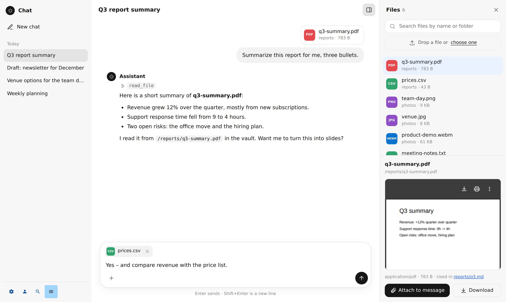

# trip2g webchat template

A [trip2g](https://github.com/trip2g/trip2g) layout: a chat page for a
[Hermes Agent](https://github.com/NousResearch/hermes-agent) API server, with a
file explorer over the site's own stored files.



- **Left** – chat sessions. **Middle** – the chat, with streaming replies.
  **Right** – files: search, preview (image, video, audio, PDF, text), upload,
  and "Attach to message", which puts the file's link and its vault path into
  the message.
- **Message box** – a paperclip (or a dropped or pasted file) attaches a file to the message as a chip; the message carries its path as `@<folder>/<name>` and the chip shows the name. With the box empty, a microphone records a voice message that goes as transcribed text with the recording's token.
- **While the agent answers** – Stop ends only the display (the agent may finish in the background; the page says so); messages typed meanwhile wait in a per-chat queue kept in this browser and go one by one when the turn ends. Under an answer: a copy button and a small gear that lists the tools used.
- **Files in answers** – `@name`, `@/opt/webchat-files/name`, `sandbox:/opt/webchat-files/…` and `MEDIA:/opt/webchat-files/…` become chips (pictures show inline); a path outside that folder is a muted chip.
- One HTML file, plain JavaScript and CSS, no build step and no external
  scripts. You (or an agent) can edit it in place in the vault.
- Light and dark, follows the site's theme toggle; one pane at a time on phones.

## Files

| File | What it is |
|---|---|
| `_layouts/webchat.html` | the whole page |
| `webchat.md` | the page note, served at `/webchat` (`layout: webchat`) |
| `_webchat/README.md` | notes for whoever edits the page: where each part lives, the rules that keep it working |
| `webchat/sessions.md`, `webchat/chat.md`, `webchat/files.md` | the chat list, the chat and the files as pages of their own (`/webchat/sessions`, `/webchat/chat`, `/webchat/files`), for putting into frames |
| `_layouts/view.html` | a page made of frames of other pages of the site, laid out from the note's `view:` |

## A page made of frames

A note with `layout: view` shows other pages of the same site side by side, in
rows or in tabs. The layout is the note's `view:` frontmatter, a tree of nodes:

| Node | Fields |
|---|---|
| `split` | `direction` (`row` or `column`), `items`, `sizes` (CSS grid: `240px`, `1fr`, `30%`), `resizable: true` for drag handles, `name` |
| `frame` | `name`, `src` (a path on this site, nothing else) |
| `tabs` | `items`: frames with a `title` |
| `message` | `text` |
| `responsive` | `branches`: `{ min, layout }`; `min` is `mobile` (0), `tablet` (768), `desktop` (1200) or a number of pixels; the widest branch that fits wins, again on every resize |

```yaml
---
title: Site project
layout: view
view:
  type: responsive
  branches:
    - min: desktop
      layout:
        type: split
        name: main
        direction: row
        sizes: ["1fr", "420px"]
        resizable: true
        items:
          - { type: frame, name: board, src: /projects/site/board }
          - { type: frame, name: chat, src: /webchat/chat }
    - min: mobile
      layout:
        type: tabs
        items:
          - { type: frame, name: board, title: Board, src: /projects/site/board }
          - { type: frame, name: chat, title: Chat, src: /webchat/chat }
---
```

- Each iframe's `name` is the frame's name, so `<a href="/webchat/chat#session=abc" target="chat">` opens a chat in the chat frame without a script.
- The chat opens `#session=<id>`, or the latest chat when the address names none, and follows `hashchange`.
- A dragged size is kept in the browser per page and split `name`, until the name or the number of items changes.
- An unknown node type, a `src` that is not a path on this site, a tree deeper than 8 levels, over 64 nodes or over 32 KB is refused with a visible "not supported".

### The agent changes the layout

An answer may carry a fenced block

````
```view
{"type":"open","target":"board","src":"/projects/other/board"}
```
````

The chat page hides it and, when the answer ends, hands it to the page around it
(`postMessage`, this origin only; the outer page accepts it only from one of its
own frames). A whole tree replaces the layout until the tab is reloaded;
`{"type":"open","target":"<frame>","src":"/path"}` changes one frame and, in
`tabs`, switches to it. The block is parsed as JSON and never run. Nothing is
stored on the server: a reload brings back the note's `view:`.

### The agent knows what is open

On every message the chat asks the outer page which frames are open and at
which paths, and sends them as `view: [{ "name": "board", "path": "/projects/site/board" }, …]`
beside the message. A name outside `[a-z][a-z0-9_-]{0,31}` or a path that is
not a plain path on this site is dropped. A chat opened on its own sends no `view`.

## Install

Copy the files into your trip2g vault at the same paths and sync. Open
`/webchat` signed in as the site admin. Copying them again resets the page.

## What it needs

### 1. A same-origin proxy to a Hermes Agent API server

The page calls the Hermes Agent API server's session endpoints on its own
origin, under one path prefix:

```js
var WEBCHAT_API_PREFIX = '/_system/webchatproxy'
```

It is the first `<script>` in `_layouts/webchat.html`; change it there if your
proxy lives elsewhere (no trailing slash). Formats are Hermes' own, unchanged.

| Method and path (after the prefix) | Request | Response fields the page reads |
|---|---|---|
| `GET /api/sessions?limit=100` | – | `data[]`: `id`, `title`, `preview`, `source`, `last_active`, `started_at` |
| `POST /api/sessions` | JSON `{}` | `session.id` |
| `PATCH /api/sessions/{id}` | JSON `{"title": "…"}` | renames a chat (click the title, the ✎ on a row, or the menu) |
| `GET /api/sessions/{id}/messages` | – | `data[]`: `role` (`user` / `assistant`; others are skipped), `content` (a string, or a list of parts with `type: "text"` / `"image_url"`) |
| `POST /api/sessions/{id}/chat/stream` | JSON `{"message": "<text>"}` (or a list of parts: text and `image_url` for pictures up to 4 MB), `Accept: text/event-stream` | server-sent events, below |

Server-sent events the page uses; every other event is ignored:

| Event | `data` fields read | What the page does |
|---|---|---|
| `assistant.delta` | `delta` | appends the text to the reply |
| `tool.started` | `tool_name` | shows "tool: name" above the reply |
| `assistant.completed` | `content` | replaces the reply with the final text |
| `error` | `message` | shows the error under the reply |

Optional, for voice messages: `GET <prefix>/api/transcribe` answers 2xx when the
proxy can turn speech into text (on any other status the microphone stays
hidden), and `POST <prefix>/api/transcribe` takes a multipart form with an
`audio` file (webm or ogg, opus) and answers JSON `{ "text": "…" }`.

Every request is `fetch` with `credentials: 'same-origin'`; POSTs carry
`Content-Type: application/json`. The page sends no token of its own:
**authentication is whatever the proxy enforces**, usually with a cookie. How
the page reads the answers:

- `401`, a redirect, or an HTML page: "Sign in", a link to
  `<prefix>/oauth2/start?rd=<this page's path>` (the oauth2-proxy sign-in path).
- `403`, `502`, `503`: "not available right now, try again".
- any other non-2xx: the status and the start of the body.

Everyone who can open the page and pass the proxy sees every session the API
lists. Restrict that in the proxy if you need to.

### 2. Libraries and files, through the same proxy

Answers are rendered with marked and DOMPurify, code with highlight.js; KaTeX
and mermaid load only when an answer has math or a mermaid block. All of them
come from the proxy, not from a CDN: `GET <prefix>/static/manifest.json` answers
`{ "marked": "marked@18.3.0.js", … }` (roles `marked`, `dompurify`, `highlight`,
`katex`, `katex.css`, `mermaid`) and `GET <prefix>/static/<file>` serves each file
with a long immutable cache. If the list cannot be read the page falls back to a
plain renderer.


Attached files and the files an agent shows live in one folder the proxy keeps
(on the agent's disk, `/opt/webchat-files`); the page never talks to the
site's own file store.

| Method and path (after the prefix) | Request | Response |
|---|---|---|
| `GET /api/files` | – | `{ "files": [{ "name", "path", "size", "modified" }] }`, newest first; `name` may carry a folder (`out/chart.png`) |
| `POST /api/files` | multipart form, one file in `file`, at most 10 MB | `{ "name", "path", "size", "modified" }`; a name never has spaces; the answer's `name` is `<folder>/<name>` |
| `GET /api/files/{name}` | – | the file's bytes; 404 once it was deleted to make room |

The message carries a file as `@<folder>/<name>` (the file
`/opt/webchat-files/<folder>/<name>` on the agent's disk; every upload gets a
folder of its own, so a name is never reused and an old link never shows another file); the agent shows a file by copying it into
`/opt/webchat-files/out/` and linking `sandbox:/opt/webchat-files/out/name`.

The sign-in button in the corner is trip2g's own
(`defaultTemplate.UserSpaceScripts()`).

## Extend

Everything is in `_layouts/webchat.html`; `_webchat/README.md` maps each part
(colours, columns, chat, streaming, markdown, file list, preview, upload,
attach) to the code. Two rules:

- trip2g's template engine (Jet) parses the whole file, the script included.
  Never write two opening curly braces in a row, or an opening curly brace
  followed by a star, outside the template calls already there.
- Never put text from a message or a file name into `innerHTML`. The page runs
  with the admin's session; use the `el(...)` helper or `textContent`.

## Tests

`tests/page.test.mjs` loads the real layout in jsdom with a stubbed API and the
libraries the proxy serves, and renders injection payloads (raw HTML, styles, forms,
remote pictures, `..` in file paths). `tests/view.test.mjs` feeds the frame layout
hostile trees (other sites, `javascript:`, depth bombs, huge JSON, unknown types,
messages from other origins); `tests/parts.test.mjs` covers the three parts, the
`#session=` address, the `view` block and the open frames sent with a message.
Run them with jsdom 24 and the library directory of the proxy:

```sh
LIBS_DIR=<webchatproxy>/internal/static/files NODE_PATH=<dir with jsdom@24>/node_modules \
  node --test tests/*.test.mjs
```
